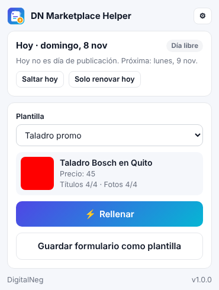
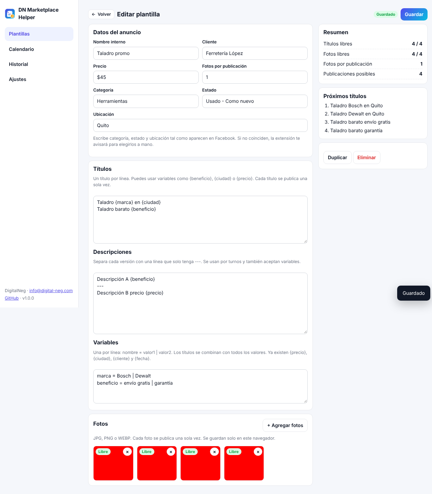

<p align="center">
  
</p>

<h1 align="center">DN Marketplace Helper</h1>

<p align="center">
  Extensión de Chrome que rellena tus publicaciones de Facebook Marketplace con un clic, usando plantillas y sin repetir títulos ni fotos.<br>
  <b>Tú siempre presionas “Publicar”.</b>
</p>

<p align="center">
  <a href="#español">Español</a> · <a href="#english">English</a>
</p>

---

## Español

### ¿Qué hace?

- **Varias plantillas o borradores**: guarda un borrador por producto o cliente y reutilízalo cuantas veces quieras.
- **Rellenar con un clic**: completa título, precio, categoría, estado, descripción, ubicación y fotos en el formulario **Artículo en venta**.
- **Sin repeticiones**: nunca usa dos veces el mismo título ni la misma foto. Te avisa cuando quedan pocos.
- **Variables**: escribe `Taladro {marca} en {ciudad}` y genera muchos títulos distintos automáticamente.
- **Duplicar y corregir**: copia una plantilla y ajusta solo lo que cambia.
- **Guardar desde Facebook**: llena un anuncio a mano una vez y presiona *Guardar formulario como plantilla*.
- **Calendario lunes, miércoles y viernes** (editable): recordatorio a las 8:00 (editable). Puedes saltar un día o marcarlo como *solo renovar*.
- **Historial**: registra qué se publicó, cuándo y para qué cliente.
- **Respaldo**: exporta e importa todos tus datos, incluidas las fotos.
- **Español e inglés.**

### Capturas

<p align="center">
  
  
</p>

### Instalación (sin la Chrome Web Store)

1. Descarga el archivo `.zip` de la última versión en [Releases](../../releases) (o *Code → Download ZIP*).
2. Descomprímelo en una carpeta que no vayas a borrar.
3. En Chrome abre `chrome://extensions`.
4. Activa **Modo de desarrollador** (arriba a la derecha).
5. Presiona **Cargar descomprimida** y elige la carpeta que contiene `manifest.json`.
6. Fija la extensión con el ícono del rompecabezas 🧩 para tenerla siempre a la vista.

### Uso rápido

1. Abre el **panel** (⚙ en la extensión) y crea una plantilla: datos, títulos, descripciones y fotos.
2. En Facebook entra a **Marketplace → Crear publicación → Artículo en venta**.
3. Abre la extensión, elige la plantilla y presiona **⚡ Rellenar**.
4. Revisa el formulario y presiona **Siguiente / Publicar** en Facebook.
5. La extensión detecta que publicaste y marca ese título y esas fotos como usados. Si no lo detecta, usa **Marcar como publicado**.

### Escribir plantillas

| Campo | Cómo se escribe |
|---|---|
| Títulos | Uno por línea. Ejemplo: `Taladro {marca} en {ciudad}` |
| Descripciones | Separa cada versión con una línea que solo tenga `---`. Se usan por turnos. |
| Variables | `nombre = valor1 \| valor2` (una por línea). Ya existen `{precio}`, `{ciudad}`, `{cliente}` y `{fecha}`. |
| Categoría, estado y ubicación | Escríbelos **tal como aparecen en Facebook** (por ejemplo, `Herramientas`). Si no coinciden, la extensión te avisa para elegirlos a mano. |

### Privacidad

Todos los datos (plantillas, fotos, historial y ajustes) se guardan **solo en tu navegador**. La extensión no tiene servidor y no envía información a nadie. Lee la [política de privacidad](PRIVACY.md).

### Aviso importante

Esta herramienta **no está afiliada a Meta ni a Facebook**. Solo rellena el formulario: **no publica sola**. Cada usuario es responsable de cumplir las [Políticas de comercio](https://www.facebook.com/policies/commerce) de Facebook. Facebook cambia su página con frecuencia; si algún campo deja de rellenarse, abre un *Issue*.

---

## English

### What it does

- **Multiple templates/drafts** per product or client.
- **One-click fill** of title, price, category, condition, description, location and photos on the **Item for sale** form.
- **No repeats**: a title or photo is never used twice; you get a warning when stock runs low.
- **Variables**: `Drill {brand} in {city}` expands into many unique titles.
- **Duplicate & edit** templates; **save a form filled by hand** as a template.
- **Mon/Wed/Fri calendar** (editable) with an 8:00 reminder (editable); skip a day or mark it *renew only*.
- **History**, **backup/restore** (including photos), **Spanish & English**.

### Install

1. Download the `.zip` from [Releases](../../releases) and unzip it.
2. Open `chrome://extensions`, enable **Developer mode**.
3. Click **Load unpacked** and pick the folder that contains `manifest.json`.

### Use

Create a template in the dashboard → open **Marketplace → Create listing → Item for sale** → open the extension → **⚡ Fill** → review and press **Publish** yourself.

### Privacy & disclaimer

All data stays in your browser; nothing is sent to any server ([privacy policy](PRIVACY.md)). Not affiliated with Meta/Facebook. The extension never publishes on its own; you are responsible for following Facebook's Commerce Policies.

---

## Desarrollo / Development

```bash
npm install
npm test        # prueba de extremo a extremo con Chrome y un formulario simulado
npm run zip     # crea dist/dn_marketplace-helper-vX.Y.Z.zip
```

Estructura:

```
manifest.json        Manifest V3
_locales/es|en       Traducciones
icons/               Logo e íconos
src/background.js    Recordatorios y registro de publicaciones
src/content.js       Rellena el formulario de Marketplace
src/popup/           Ventana de la extensión
src/options/         Panel: plantillas, calendario, historial, ajustes
src/lib/             Lógica compartida (datos, rotación, calendario, idioma)
test/                Prueba automatizada
```

## Licencia

[MIT](LICENSE) © DigitalNeg · [info@digital-neg.com](mailto:info@digital-neg.com)
